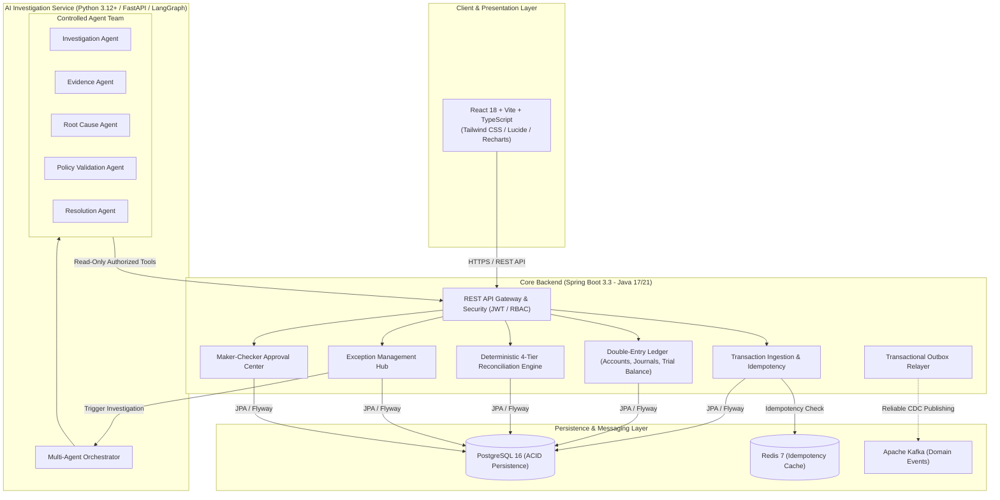

<p align="center">
  
</p>

# FinPilot ⚡
### Enterprise Financial Operations, Double-Entry Ledger & Agentic Reconciliation Platform

[](https://github.com/SAIYAMgade/FinPilot/actions/workflows/ci.yml)
[](https://openjdk.org/)
[](https://spring.io/projects/spring-boot)
[](https://python.org/)
[](https://fastapi.tiangolo.com/)
[](https://react.dev/)
[](https://www.typescriptlang.org/)
[](https://www.postgresql.org/)
[](https://www.docker.com/)

---

## 1. Executive Overview & Problem Statement

Modern financial operations teams process millions of transactions across disparate payment gateways, banking partners, and enterprise ledgers. Traditional reconciliation platforms suffer from two major flaws:
1. **Brittle Rule Engines**: They generate thousands of unmatched exceptions that require slow manual human investigation.
2. **Uncontrolled LLM Hallucinations**: Naive AI chatbots cannot guarantee financial correctness, lack auditability, and risk catastrophic unauthorized balance modifications.

**FinPilot** is an enterprise-grade financial operations platform combining **deterministic financial engineering** with **controlled, auditable multi-agent AI investigation**:
- **Deterministic Core**: Double-entry ledger postings, mathematical invariant checks ($\sum \text{Debits} = \sum \text{Credits}$), idempotency deduplication, and 4-tier statement matching are executed exclusively by deterministic Java code.
- **Controlled Multi-Agent AI**: Specialized LangGraph agents investigate discrepancies, cite verified evidence, deduce root causes, check compliance policies, and propose adjustments.
- **Zero Autonomous AI Mutation**: AI agents have strictly read-only tools. Under no circumstances can an AI agent modify ledger balances or bypass human authorization.
- **Maker-Checker Governance**: All financial adjustments mandate two-party segregation of duties. Self-approval is cryptographically and logically prohibited.

---

## 2. System Architecture

<p align="center">
  
</p>



---

## 3. Technology Stack

| Layer | Technologies |
|---|---|
| **Frontend** | React 18, TypeScript, Vite, Tailwind CSS, Lucide icons, Recharts, Axios |
| **Core Backend** | Java 17/21, Spring Boot 3.3.4, Spring Security, Spring Data JPA, Hibernate, Flyway, Apache Commons CSV, SpringDoc OpenAPI |
| **AI Backend** | Python 3.12+, FastAPI, LangGraph, Pydantic v2, Pytest |
| **Datastores & Messaging** | PostgreSQL 16, Redis 7, Apache Kafka & Zookeeper |
| **DevOps & Cloud** | Multi-stage Docker, Docker Compose, GitHub Actions, AWS ECS Fargate, AWS RDS, AWS S3 |

---

## 4. Pre-Seeded Demo Accounts

FinPilot provides seeded demo accounts for local evaluation with pre-configured chart of accounts, sample transactions, and active exception cases:

| Role | Username | Password | Email | Assigned Capabilities |
|---|---|---|---|---|
| **ADMIN** | `admin` | `Password@123` | `admin@finpilot.io` | Full platform administration, accounts setup, user provisioning |
| **FINANCE_ANALYST** | `analyst` | `Password@123` | `analyst@finpilot.io` | Ingest payments, execute reconciliation, run AI investigations, propose adjustments |
| **FINANCE_APPROVER** | `approver` | `Password@123` | `approver@finpilot.io` | Maker-Checker second-party authorization, approve/reject adjustment proposals |
| **AUDITOR** | `auditor` | `Password@123` | `auditor@finpilot.io` | Read-only inspection of transactions, ledgers, trial balances, and immutable audit logs |

---

## 5. Quickstart Guide

### Option A: Complete Docker Compose (Recommended)
Launch all subsystems (Postgres, Redis, Zookeeper, Kafka, Spring Boot backend, FastAPI AI service, and React frontend) with a single command:

```bash
# 1. Clone repository
git clone https://github.com/SAIYAMgade/FinPilot.git
cd FinPilot

# 2. Start container stack
docker compose up -d --build

# 3. Access applications:
# Frontend: http://localhost:3000
# Backend API: http://localhost:8080/api/v1
# Swagger UI: http://localhost:8080/swagger-ui.html
# Actuator Health: http://localhost:8080/actuator/health
# AI Service: http://localhost:8000/docs
```

### Option B: Local Standalone Development
You can also run services individually without external infrastructure:

```bash
# 1. Start Java Backend (uses in-memory PostgreSQL-compatible mode with Flyway & Seeder)
cd backend
mvn spring-boot:run

# 2. Start Python AI Service (in a second terminal)
cd ../ai-service
pip install -r requirements.txt
uvicorn main:app --port 8000 --reload

# 3. Start React Frontend (in a third terminal)
cd ../frontend
npm install
npm run dev
# App will open at http://localhost:5173
```

---

## 6. End-to-End Walkthrough Scenario

Follow this guided workflow to evaluate FinPilot's capabilities:

1. **Sign In**: Navigate to `http://localhost:3000/login` and click **"Finance Analyst"** (`analyst` / `Password@123`).
2. **Ingest Transactions**: Go to `/transactions` and ingest a payment with an idempotency key. Notice that re-submitting identical requests returns the original transaction with zero duplicate records.
3. **Execute Statement Reconciliation**: Navigate to `/reconciliations/new`, click **"Download Sample CSV"**, upload the settlement file, and click **"Execute 4-Tier Reconciliation Match"**.
4. **Review 4-Tier Matches**: Inspect the results on `/reconciliations/:id`. Observe Level 1 exact matches, Level 2 amount mismatches, and automatically created exception cases.
5. **Launch AI Multi-Agent Investigation**: Go to `/exceptions`, open case **EXP-1044** (₹1,500 discrepancy), and click **"Launch AI Investigation"**.
6. **Inspect Evidence & Probabilities**: Watch the 5-agent LangGraph pipeline ingest context, cite evidence IDs, deduce root causes (94.5% probability of gateway fee withholding), and verify tolerance thresholds.
7. **Submit Adjustment Proposal**: Click **"Submit for Maker-Checker Approval"** and route the proposal for independent authorization.
8. **Enforce Separation of Duties**: Go to `/approvals` as the analyst and attempt to approve your own proposal. Observe that FinPilot immediately blocks self-approval with `HTTP 403 Forbidden`!
9. **Switch to Approver & Authorize**: Click the **"Approver"** quick persona button (Sarah Jenkins) and click **"Authorize & Execute Adjustment"**.
10. **Verify Ledger Invariant & Audit Trail**: Go to **Journal Entries** (`/journals`) and **Trial Balance** (`/trial-balance`) to confirm the adjustment entry was posted with mathematical equilibrium ($\sum \text{Debits} = \sum \text{Credits}$). Inspect `/audit-logs` for the cryptographic before/after trail.

---

## 7. Synthetic Data Generator (10,000+ Transactions)

FinPilot includes a deterministic synthetic data generator producing over 10,000 realistic transactions with companion external bank settlement records:

```bash
python scripts/generate_synthetic_data.py --count 10000 --seed 42
# Output:
# Generated transactions_10k.csv with 10000 rows.
# Generated bank_statement_10k.csv with 9771 rows.
```

---

## 8. Automated Testing & Verification

Every critical constraint is verified by automated test suites:

```bash
# Run Java Backend JUnit 5 Suite (7 tests, 0 failures)
cd backend && mvn test

# Run Python Multi-Agent Pytest Suite (2 tests, 0 failures)
cd ../ai-service && python -m pytest tests/

# Run Frontend Typecheck & Build (0 errors)
cd ../frontend && npm run build
```

---

## 9. Comprehensive Documentation Sitemap

- [System Architecture & Blueprint](docs/architecture.md)
- [Database Schema & ER Diagrams](docs/database-design.md)
- [REST API Reference & Contracts](docs/api-reference.md)
- [Security & Segregation of Duties](docs/security.md)
- [Automated Testing & Verification Report](docs/testing.md)
- [Docker & AWS Cloud Deployment Guide](docs/deployment.md)
- [10-Step Guided Demo Walkthrough](docs/demo-scenarios.md)

---

## 10. Engineering Portfolio Note & Technical Interview Ready
FinPilot is structured and coded to the standards of senior financial software architecture. It demonstrates:
- Double-entry accounting invariants and concurrency safety
- Transactional Outbox Pattern for distributed event delivery
- Controlled multi-agent AI with bounded read-only tool invocation
- Two-party maker-checker segregation of duties
- Clean, type-safe, and auditable code across Java, Python, and TypeScript.
