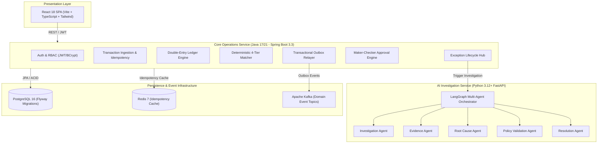
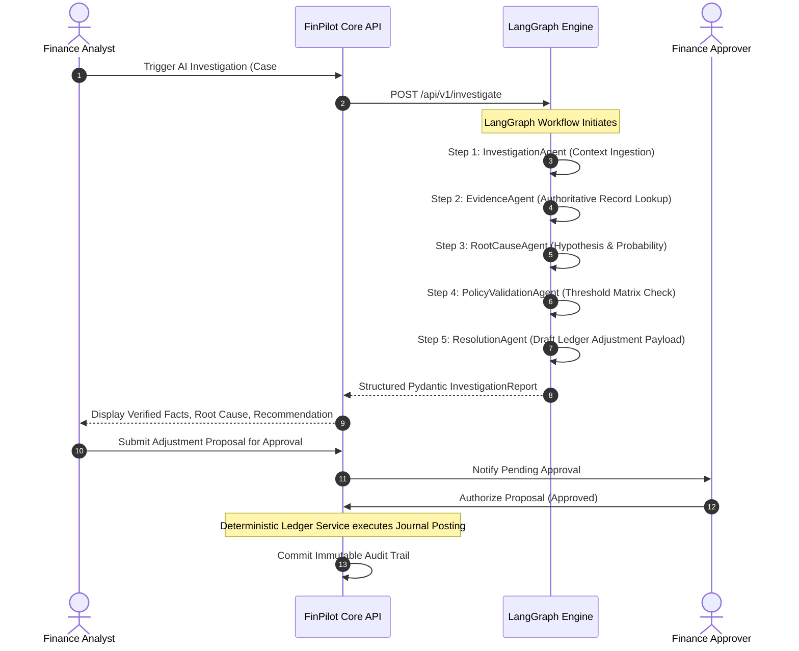

# FinPilot: System Architecture & Design Blueprint

## 1. Architectural Philosophy

FinPilot bridges the gap between **deterministic financial accounting** and **autonomous AI-driven investigation**. The system guarantees mathematical ledger invariants while empowering operations teams with controlled AI agents to explain discrepancies and formulate audit-ready corrections.

### The Five Invariants
1. **Mathematical Invariant**: In double-entry posting, $\sum \text{Debits} = \sum \text{Credits}$ is enforced at the domain, application, and database levels. Unbalanced transactions cannot be committed.
2. **AI Mutation Prohibition**: AI agents possess read-only tool privileges. No LLM or agent can directly mutate account balances, change ledger states, or post journal lines.
3. **Idempotency Guarantee**: Ingestion endpoints require an idempotency key. A retry of the same payload returns the original result with 0 side-effects; conflicting parameters on the same key trigger an HTTP 409 Conflict.
4. **Segregation of Duties (Maker-Checker)**: An adjustment proposal submitted by a Finance Analyst must be authorized by an independent Finance Approver. Self-approval is blocked by authorization filters.
5. **Deterministic Multi-Tier Matching**: Reconciliation matching strictly employs four deterministic levels of validation. Discrepancies generate trackable exception records.

---

## 2. Component Topology

---

## 3. Asynchronous Messaging & Transactional Outbox Pattern

To eliminate dual-write hazards between relational persistence and Kafka event dispatching, FinPilot employs the **Transactional Outbox Pattern**:
1. When a transaction changes state or an adjustment is approved, the domain event is serialized to JSON and persisted into the `outbox_events` table within the same atomic database transaction.
2. An asynchronous scheduler (`OutboxPublisherService`) polls pending records every 5,000ms.
3. Events are published to Kafka topics (`transactions-topic`, `reconciliation-topic`, `approvals-topic`).
4. Upon successful Kafka delivery acknowledgment, the outbox record status updates to `PUBLISHED`.
5. If Kafka is temporarily unreachable, exponential backoff retries preserve event delivery without impacting core API latency.

---

## 4. Multi-Agent AI Workflow

