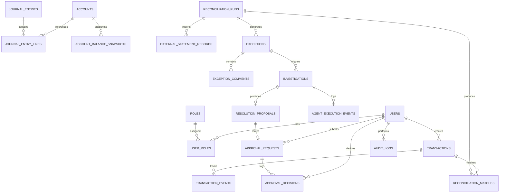

# FinPilot: Database Design & Schema Specification

## 1. Relational Entity Relationship Diagram

---

## 2. Table Specifications & Precision Guarantees

### Monetary Precision
All monetary amounts use `NUMERIC(19, 4)` in PostgreSQL and `BigDecimal` in Java. Floating-point arithmetic (`float`, `double`) is strictly prohibited.

| Table Name | Primary Key | Critical Constraints | Purpose |
|---|---|---|---|
| `users` | `VARCHAR(36)` | Unique username & email | Operator identities |
| `roles` | `VARCHAR(36)` | Unique role name (`ADMIN`, `FINANCE_ANALYST`, etc.) | System roles |
| `accounts` | `VARCHAR(36)` | Unique account number | Chart of accounts |
| `transactions` | `VARCHAR(36)` | Unique `idempotency_key`, indexed `status`, `created_at` | Payment ingestion ledger |
| `transaction_events` | `VARCHAR(36)` | FK to `transactions(id)` | Transaction state transition history |
| `journal_entries` | `VARCHAR(36)` | Indexed `reference_id`, `posting_status` | Double-entry journal header |
| `journal_entry_lines` | `VARCHAR(36)` | Non-negative debits/credits | Individual journal line items |
| `reconciliation_runs` | `VARCHAR(36)` | Unique `run_number`, SHA-256 checksum | Statement reconciliation runs |
| `external_statement_records` | `VARCHAR(36)` | FK to `reconciliation_runs(id)` | Bank settlement statement rows |
| `reconciliation_matches` | `VARCHAR(36)` | Match score, difference, match level | Match classification results |
| `exceptions` | `VARCHAR(36)` | Unique `exception_number` | Operational discrepancies |
| `investigations` | `VARCHAR(36)` | FK to `exceptions(id)` | AI agent investigation runs |
| `agent_execution_events` | `VARCHAR(36)` | FK to `investigations(id)` | Tool calls and agent traces |
| `resolution_proposals` | `VARCHAR(36)` | FK to `exceptions(id)`, debit/credit accounts | Adjustment proposals |
| `approval_requests` | `VARCHAR(36)` | Unique `request_number`, expiration timestamp | Maker-checker workflows |
| `approval_decisions` | `VARCHAR(36)` | FK to `approval_requests(id)` | Signed decisions (Approved/Rejected) |
| `audit_logs` | `VARCHAR(36)` | Indexed `entity_type`, `entity_id`, `created_at` | Immutable compliance audit trail |
| `outbox_events` | `VARCHAR(36)` | Indexed `status` (`PENDING`, `PUBLISHED`, `FAILED`) | Outbox event delivery |

---

## 3. Database Migration Strategy
- Managed via **Flyway** in `src/main/resources/db/migration/`.
- `V1__init_schema.sql`: Complete DDL establishing primary keys, foreign keys, indexes, and precision constraints.
- `V2__seed_demo_data.sql`: Seed data for standard roles and chart of accounts.
- Zero destructive schema alterations (`DROP TABLE`, un-migrated column renames) are permitted.
