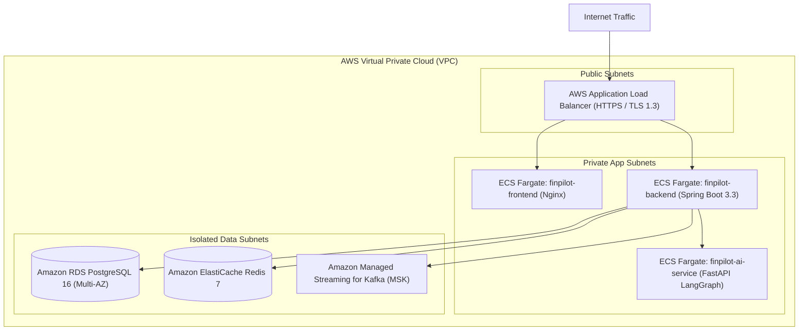

# FinPilot: Cloud & Local Deployment Guide

## 1. Local Deployment with Docker Compose

FinPilot can be launched locally using Docker Compose:

```bash
# Clone and enter workspace
git clone <repo-url> finpilot
cd finpilot

# Start all subsystems (Postgres, Redis, Zookeeper, Kafka, Backend, AI, Frontend)
docker compose up -d --build
```

### Local Endpoint Map:
- **Frontend SPA**: `http://localhost:3000`
- **Core Operations API**: `http://localhost:8080/api/v1`
- **Swagger UI**: `http://localhost:8080/swagger-ui.html`
- **Actuator Health**: `http://localhost:8080/actuator/health`
- **AI LangGraph Service**: `http://localhost:8000/docs`
- **PostgreSQL**: `localhost:5432` (`finpilot_user` / `finpilot_secret`)
- **Redis Cache**: `localhost:6379`
- **Kafka Broker**: `localhost:9092`

---

## 2. Production AWS Deployment Architecture

FinPilot is engineered for modern AWS containerized infrastructure:



### AWS Service Configuration
1. **AWS ECS (Fargate)**: Container execution without server maintenance. Task sizes:
   - Backend: 2 vCPU, 4 GB RAM
   - AI Service: 1 vCPU, 2 GB RAM
   - Frontend: 0.5 vCPU, 1 GB RAM
2. **Amazon RDS for PostgreSQL**: PostgreSQL 16 with Multi-AZ failover and automated daily snapshots.
3. **Amazon ElastiCache for Redis**: Distributed caching and idempotency deduplication with automatic replication.
4. **Amazon S3**: Statement CSV uploads and permanent evidence vault storage with Server-Side Encryption (SSE-KMS).
5. **AWS Secrets Manager**: Automatic rotation of DB credentials and JWT signing keys.
6. **Amazon CloudWatch**: Centralized structured JSON log aggregation and Prometheus metrics alerting.

---

## 3. Zero-Downtime Rollback Procedure
1. ECS rolling deployments maintain a minimum healthy percent of 100%.
2. If health checks fail during rollout, ECS automatically drains traffic and reverts to the previous task definition revision.
3. Database migrations in Flyway follow backward-compatible expansion rules, preventing deployment deadlocks.
